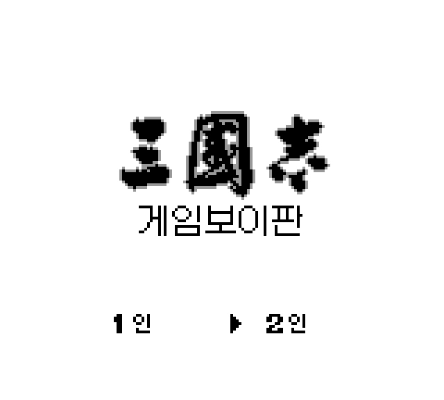
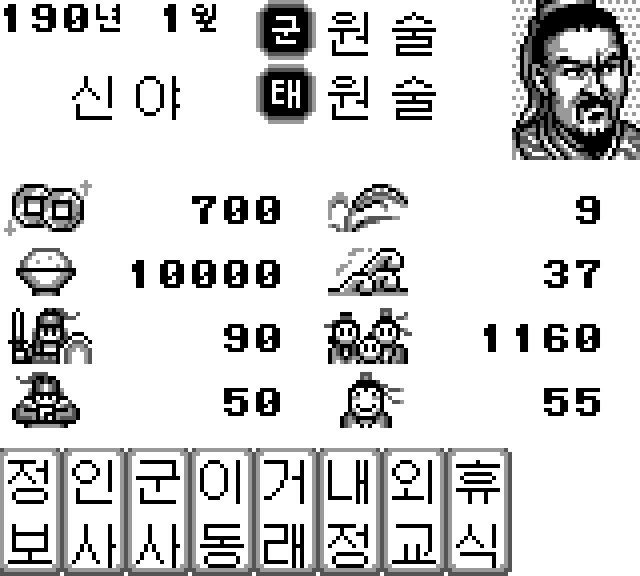
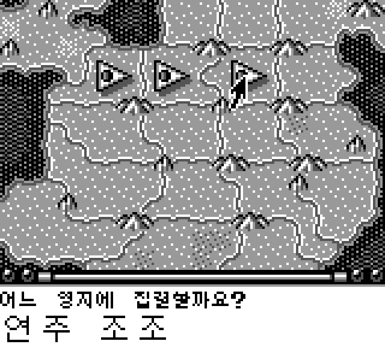
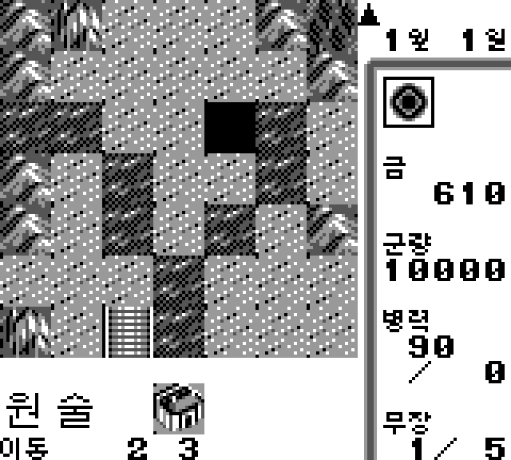

# 삼국지 한글패치

게임보이판 삼국지에 한국어 번역을 추가해주는 xdelta파일입니다.

## 샘플 이미지

  
   
  
  

## 요구 사항

* Windows 10 이상
* 사용자가 직접 덤프한 정품 게임 파일

## 해시정보

[원본 ROM]
크기: 262144 bytes
SHA-256: A9B8C50C84B6F33EC29025A76420D5AD098D6B1B99EA9798976D758755F73256
SHA-1: E94128D58341CAAEE595ED75292908A9AC5A466D
MD5: 85082BCBDA4FEBF4E9E05FA0679940B4
CRC32: 83706E92

[패치 후 ROM]
크기: 524288 bytes
SHA-256: CC073E49E879CD1844A77458ED80C538DA3546095108E5093C529DF22EDDC138
SHA-1: 5126E2DC5027D862D577CCCC19FF1F6F997EE7CC
MD5: 2EC7041ECE5BBFEAB86B273DDA6417D0
CRC32: 203D7E8D

[xdelta 패치]
크기: 16862 bytes
SHA-256: 2C0FFC1B6A84577E66A3AE28CD32FF58659A8D4419C515B91B97536DF1F05A52
SHA-1: ADE27E177A339C9188BBC75E663B0070EF0A50AE
MD5: 6C0ADD8F4ED65F6FF0A4CAEC6A0449DB
CRC32: 35F9B2EC

## 다운로드

**[릴리즈 페이지](../../releases)** 에서 다운로드하세요.

본 패치를 다운로드하거나 사용하는 경우 아래의 면책조항 및 이용안내를 확인하고 이에 동의한 것으로 간주합니다.

## 면책조항

본 프로젝트는 비영리 목적의 팬 번역 프로젝트이며, 원작의 저작권은 해당 권리자에게 있습니다.

본 프로젝트는 게임 데이터, 실행 파일 또는 기타 저작권이 있는 원본 데이터를 포함하거나 배포하지 않습니다.

패치를 사용하려면 사용자가 합법적으로 취득한 원본 게임이 필요합니다.

프로젝트 운영자는 본 패치의 사용으로 인해 발생하는 어떠한 손해나 문제에 대해서도 책임을 지지 않습니다.

권리자의 요청이 있을 경우 본 프로젝트는 관련 자료의 공개를 중단하거나 삭제하는 등 필요한 조치를 취할 수 있습니다.

## 라이선스

이 프로젝트는 MIT License를 따릅니다. 자세한 내용은 LICENSE 파일을 참고해 주세요.

Copyright (c) 2026 Gideon

---

Developed with GPT-6.1
